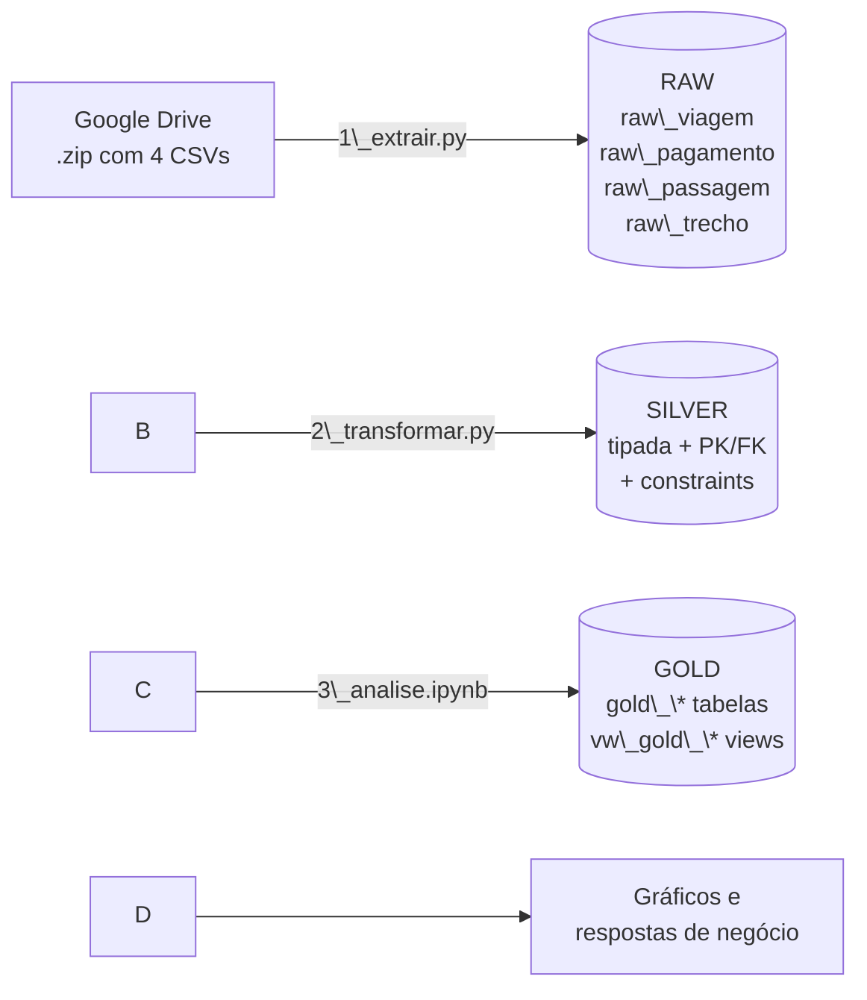

# Pipeline de Dados — Viagens a Serviço do Governo Federal (1º sem/2025)

Pipeline ETL de ponta a ponta, em **Python + PostgreSQL**, que transforma os dados brutos de
**Viagens a Serviço** do Portal da Transparência em métricas e gráficos para tomada de decisão,
seguindo a **Arquitetura Medallion** (Raw → Silver → Gold).

## 1\. Problema

O Portal da Transparência publica os dados de viagens em CSVs brutos: separador `;`,
encoding `latin-1`, valores com vírgula decimal (`1272,97`) e datas em texto (`DD/MM/AAAA`).
Nesse formato não é possível somar valores, calcular durações nem cruzar tabelas com segurança.
Este projeto automatiza todo o caminho, do download até as respostas de negócio.

## 2\. Arquitetura



|Camada|Tabelas|Conteúdo|
|-|-|-|
|Raw|`raw\_viagem`, `raw\_pagamento`, `raw\_passagem`, `raw\_trecho`|Cópia fiel do CSV, todas as colunas `VARCHAR` (sem limite), sem constraints|
|Silver|`silver\_viagem`, `silver\_pagamento`, `silver\_passagem`, `silver\_trecho`|Dados limpos e tipados (`DECIMAL`, `DATE`, `INT`), com PK, FK e constraints|
|Gold|`gold\_\*` (tabelas) e `vw\_gold\_\*` (views)|Agregações com `JOIN` + `GROUP BY`|

### Modelo relacional (Silver)

```mermaid
erDiagram
    silver\_viagem ||--o{ silver\_pagamento : "id\_viagem"
    silver\_viagem ||--o{ silver\_passagem  : "id\_viagem"
    silver\_viagem ||--o{ silver\_trecho    : "id\_viagem"
```

Constraints declaradas no `CREATE TABLE`:

|Tabela|Constraint 1|Constraint 2|
|-|-|-|
|silver\_viagem|`NOT NULL` em `nome\_orgao\_superior`|`CHECK (valor\_diarias >= 0)`|
|silver\_pagamento|`CHECK (valor >= 0)`|`NOT NULL` em `tipo\_pagamento`|
|silver\_passagem|`CHECK (valor\_passagem >= 0)`|`CHECK (taxa\_servico >= 0)`|
|silver\_trecho|`CHECK (numero\_diarias >= 0)`|`UNIQUE (id\_viagem, sequencia\_trecho)`|

## 3\. Tecnologias e técnicas

* **Python 3** — pandas (leitura em blocos/`chunksize`), gdown (download do Drive), matplotlib (gráficos)
* **PostgreSQL** — DDL com PK, FK, `CHECK`, `UNIQUE`, `IDENTITY`, `VIEW`, `CREATE TABLE AS SELECT`
* **psycopg2** — conexão Python ↔ PostgreSQL, inserção em lote com `execute\_values`
* **ETL idempotente** — `TRUNCATE` antes de cada carga: reexecutar não duplica dados
* **Resiliência** — `try/except` em cada etapa, com conferência de linhas CSV × banco
* **Tipagem com funções dedicadas** — `texto\_para\_decimal`, `texto\_para\_data`, `texto\_para\_inteiro`
* **Integridade referencial** — filhas só entram na Silver se a viagem existir
* **Boas práticas** — credenciais no `.env`, `.gitignore`, PEP-8, código modularizado

## 4\. Estrutura do repositório

```
├── 0\_criar\_banco.sql     # Fase 0: database + 8 tabelas
├── 1\_extrair.py          # Fase 1: download + carga Raw
├── 2\_transformar.py      # Fase 2: limpeza/tipagem Raw -> Silver
├── 3\_analise.ipynb       # Fase 3: camada Gold + perguntas + gráficos
├── config.py             # parâmetros e leitura do .env
├── banco.py              # conexão e utilitários de banco
├── img/                  # gráficos exportados pelo notebook
├── .env.example          # modelo de credenciais
├── .gitignore
├── requirements.txt
└── README.md
```

## 5\. Como executar

**Pré-requisitos:** Python 3.10+ e PostgreSQL 13+ instalados. Os comandos abaixo são para o
Prompt de Comando do Windows (em Linux/Mac, troque `py` por `python3` e use `source .venv/bin/activate`).

```bat
:: 1. Clonar e entrar no projeto
git clone https://github.com/meninodeminas/Projeto-Avaliativo-Modulo1-PedroSouza.git 
cd Projeto-Avaliativo-Modulo1-PedroSouza

:: 2. Ambiente virtual e dependências
py -m venv .venv
.venv\\Scripts\\activate
python -m pip install -r requirements.txt

:: 3. Credenciais: copie o modelo e coloque a senha do PostgreSQL em DB\_PASSWORD
copy .env.example .env
notepad .env

:: 4. Banco e tabelas (psql fica em "C:\\Program Files\\PostgreSQL\\<versão>\\bin\\psql.exe")
psql -U postgres -h localhost -c "CREATE DATABASE viagens\_db ENCODING 'UTF8';"
psql -U postgres -h localhost -d viagens\_db -f 0\_criar\_banco.sql

:: 5. Pipeline (o link da pasta do Google Drive já está configurado no config.py)
python 1\_extrair.py
python 2\_transformar.py
python -m notebook 3\_analise.ipynb
```

No Jupyter, use **Run → Restart Kernel and Run All Cells**. Se o navegador não abrir sozinho,
copie do terminal o endereço `http://localhost:8888/...` (com o token) e cole no navegador.

## 6\. Regras de transformação (Raw → Silver)

|Regra|Implementação|
|-|-|
|Texto → DECIMAL|`'1.272,97'` → `1272.97` (remove milhar, troca vírgula por ponto)|
|Texto → DATE|`'05/01/2025'` → `2025-01-05`; datas inválidas viram `NULL`|
|Vazios|`''` e `'Sem informação'` viram `NULL`|
|Duplicidades|viagem duplicada por `id\_viagem`; trecho por `(id\_viagem, sequencia\_trecho)`; linhas idênticas em pagamento/passagem|
|Integridade|registros filhos sem viagem correspondente são descartados|
|`valor\_total`|diárias + passagens + outros gastos − devolução|
|`duracao\_dias`|`data\_fim − data\_inicio + 1` (ida e volta no mesmo dia = 1 dia)|

O `2\_transformar.py` imprime quantas linhas foram descartadas em cada regra.

## 7\. Perguntas de negócio e resultados

As perguntas 1 a 3 foram respondidas diretamente na camada Silver; as perguntas 4 a 7, a partir
da camada Gold (`gold\_\*` / `vw\_gold\_\*`).

|#|Pergunta|Resposta|
|-|-|-|
|1|Órgão com maior custo total|**Ministério da Justiça e Segurança Pública** — R$ 486.933.121,65|
|2|Destino com maior custo médio por viagem|Pelo campo `destinos`: Abu Dabi/Riad/Rio de Janeiro — R$ 245.852,80 (**1 única viagem**). Pelo destino do 1º trecho, com no mínimo 30 viagens: **Jacareacanga/PA** — R$ 44.565,53 (95 viagens)|
|3|Viagem de maior duração e seu custo|Viagem 0000000000020699856 — 384 dias, R$ 0,00 (*outlier*). Entre as viagens com custo: 0000000000020793594 (MJSP) — 379 dias, R$ 120.650,00|
|4|Tipo de pagamento com maior valor médio|**PASSAGEM** — R$ 1.856,78 por pagamento|
|5|Meio de transporte mais usado nos trechos|**Veículo Oficial** — 386.424 trechos|
|6|UF de destino com mais trechos|**São Paulo** — 82.722 trechos|
|7|Órgão que pagou mais no total|**Sigiloso** — R$ 170.659.883,35 (16,9% do total). Entre os identificados: Fundo Nacional de Segurança Pública — R$ 141,9 milhões|

### Análises complementares

Além das 7 perguntas, três consultas extras foram feitas para checar a qualidade das respostas:

* **Destino real da viagem (pergunta 2).** O campo `destinos` guarda o roteiro completo, e os 3
primeiros colocados eram viagens únicas. Usando o destino do primeiro trecho e exigindo pelo menos
30 viagens, o ranking fica: Jacareacanga/PA (R$ 44,6 mil), Tucumã/PA (R$ 34,2 mil),
Itaituba/PA (R$ 27,1 mil), Guaíra/PR (R$ 25,7 mil) e Atalaia do Norte/AM (R$ 19,0 mil).
* **Viagens longas (pergunta 3).** Há 2.273 viagens com mais de 180 dias, 52 delas com custo zero.
96% são do MJSP; dessas, 1.351 (62%) citam a **Força Nacional** no motivo e somam R$ 146,9 milhões.
* **Órgãos pagadores identificados (pergunta 7).** Sem o "Sigiloso", o ranking é: Fundo Nacional de
Segurança Pública (R$ 141,9 mi, 24.116 viagens), Comando da Aeronáutica (R$ 81,2 mi, 32.336 viagens),
Comando do Exército (R$ 35,9 mi), INSS (R$ 35,4 mi) e Ministério da Gestão e da Inovação (R$ 34,6 mi).

### Gráficos

!\[Top 5 órgãos por custo total](img/q1\_top5\_orgaos\_custo.png)
!\[Top 3 destinos por custo médio](img/q2\_top3\_destinos\_custo\_medio.png)
!\[Top 3 destinos com no mínimo 30 viagens](img/q2b\_top3\_destinos\_robusto.png)
!\[Viagens de maior duração](img/q3\_viagens\_maior\_duracao.png)
!\[Valor médio por tipo de pagamento](img/q4\_valor\_medio\_tipo\_pagamento.png)
!\[Trechos por meio de transporte](img/q5\_trechos\_por\_transporte.png)
!\[Top 10 UFs de destino](img/q6\_top10\_uf\_destino.png)
!\[Top 10 órgãos pagadores](img/q7\_top10\_orgaos\_pagadores.png)

## 8\. Conclusões e insights

1. **A segurança pública domina o gasto com viagens.** O MJSP é o órgão de maior custo
(R$ 486,9 milhões no semestre) e o Fundo Nacional de Segurança Pública é o maior pagador identificado.
2. **Cerca de metade do custo do MJSP vem de mobilizações longas.** As viagens do MJSP com mais de
180 dias somam R$ 241,4 milhões, e 62% delas citam a Força Nacional no motivo. Nesses casos, duração
longa é o modelo de operação, e não erro de registro.
3. **Os destinos mais caros são remotos.** Pelo destino do primeiro trecho, os maiores custos médios
estão em municípios da Amazônia (Jacareacanga, Tucumã, Itaituba) e de fronteira (Guaíra, Atalaia do
Norte), regiões de difícil acesso que exigem permanências longas.
4. **O deslocamento é principalmente terrestre e operacional.** Veículo Oficial é o meio mais usado,
e São Paulo supera o Distrito Federal como UF de destino, o que indica muitas operações em campo nos
estados, e não apenas idas à capital.
5. **Há limites de transparência e de qualidade nos dados.** 16,9% do valor pago é "Sigiloso" e não
pode ser auditado; o campo `destinos` mistura roteiros inteiros; e existem viagens com duração
atípica e custo zero, que precisam ser tratadas como *outliers* antes de qualquer conclusão.

## 9\. Melhorias futuras

* Orquestrar o pipeline (Airflow/Prefect) com execução agendada
* Carga incremental por mês em vez de recarga completa
* Testes automatizados (pytest) para as funções de conversão
* Normalizar o campo `destinos` (uma linha por cidade) para análises mais precisas
* Dashboard interativo (Power BI / Streamlit) sobre as views Gold

